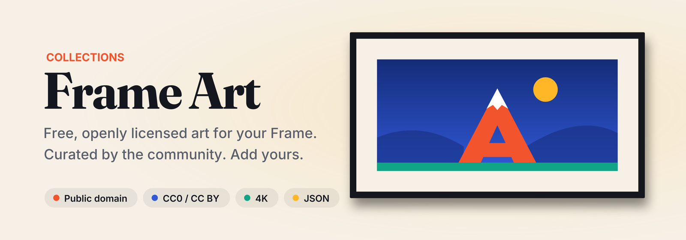
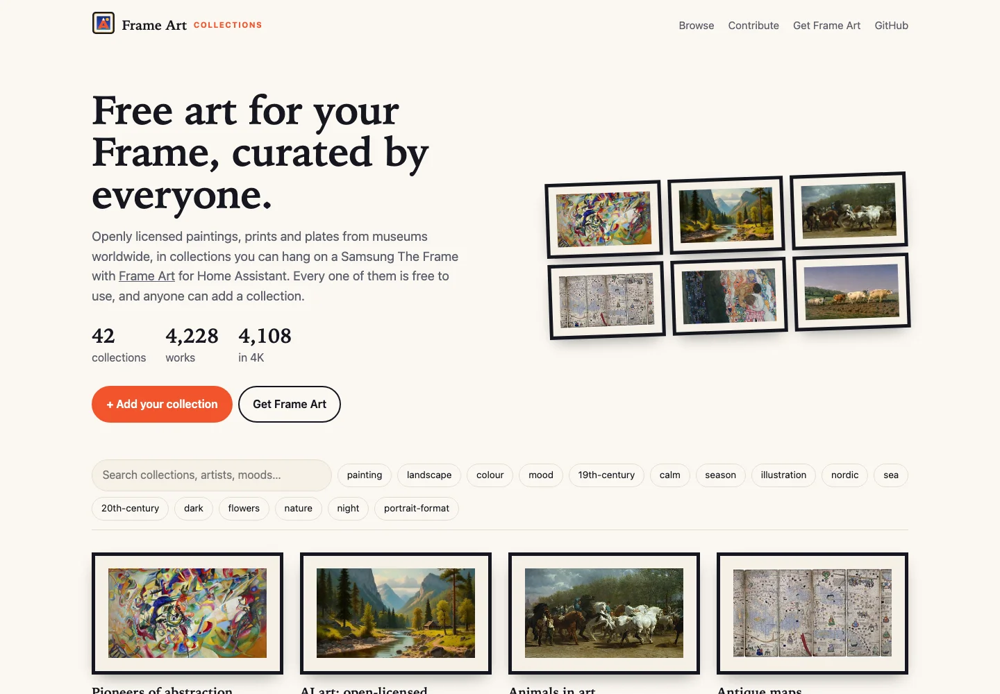

<p align="center">
  <picture>
    <source media="(prefers-color-scheme: dark)" srcset="site/brand/collections-banner-dark.png">
    
  </picture>
</p>

<p align="center">
  <a href="https://dstollie.github.io/frame-art-collections/"></a>
  <a href="https://dstollie.github.io/frame-art-collections/"></a>
  <a href="https://github.com/dstollie/frame-art-collections/actions/workflows/ci.yml"></a>
  <a href="https://github.com/dstollie/frame-art-collections/labels/good%20first%20collection"></a>
  <a href="LICENSE"></a>
  <a href="https://github.com/dstollie/frame-art-collections/stargazers"></a>
</p>

<p align="center">
  <a href="https://github.com/dstollie/frame-art-collections/issues/new?template=new-collection.yml"></a>
  &nbsp;
  <a href="https://dstollie.github.io/frame-art-collections/"></a>
</p>

Free, community-curated art collections for [Samsung The Frame](https://www.samsung.com/the-frame/), made for [Frame Art](https://github.com/dstollie/ha-frame-art), the Home Assistant app that puts art on your Frame TVs. Every Frame Art user gets these collections, so **a collection you add here hangs on walls around the world.**

A collection is a small JSON file: a title, a description and a list of artworks with links to images that museums and Wikimedia Commons already host. Nothing is uploaded here, nothing costs money, and every work is public domain or under an open licence (CC0, CC BY, CC BY-SA).

<p align="center">
  <a href="https://dstollie.github.io/frame-art-collections/"></a>
</p>

**Browse:** <https://dstollie.github.io/frame-art-collections/> · **Index for apps:** <https://dstollie.github.io/frame-art-collections/index.json> · **Talk:** [Discussions](https://github.com/dstollie/frame-art-collections/discussions)

## 🎨 Add a collection

No idea where to start? Pick an issue labelled [good first collection](https://github.com/dstollie/frame-art-collections/labels/good%20first%20collection), or [suggest a theme](https://github.com/dstollie/frame-art-collections/issues/new?template=collection-idea.yml) for someone else to pick up.

All three routes end in a pull request that CI checks: schema, open licences only, no duplicates, resolution (an error below 1920 px on the long edge, a warning below 3840 px), and a sampled check that image URLs load and match the declared size.

### 1. Ask an AI agent

This repo ships an agent skill at [`.agents/skills/add-collection/SKILL.md`](.agents/skills/add-collection/SKILL.md) (also at `.claude/skills/add-collection`). Clone the repo, open it in Claude Code, Codex or another agent that reads skills, and say:

> Add a collection of misty landscapes.

The agent searches for openly licensed, high-resolution works, writes the manifest with `pnpm new`, validates it and opens a pull request.

### 2. Fill in an issue form

[Open a "New collection" issue](https://github.com/dstollie/frame-art-collections/issues/new?template=new-collection.yml), give it a title and description, and paste links to the works: Wikimedia Commons file pages, Wikidata items, SMK or Met object pages. A bot looks them up, writes the manifest and opens a pull request for you. Works it can't use are listed in a comment with the reason.

### 3. Open a pull request yourself

```sh
pnpm install
cat > works.txt <<'EOF'
https://commons.wikimedia.org/wiki/File:Claude_Monet_-_Water_Lilies_-_1906,_Ryerson.jpg
Q12418
https://open.smk.dk/artwork/image/KMS3352
https://www.metmuseum.org/art/collection/search/436535
EOF
pnpm new --id my-collection --title "My collection" \
  --description "What ties these works together, in a sentence or two." \
  --tags painting,calm --curator "Your Name" --github your-handle --works works.txt
pnpm validate
pnpm validate:urls collections/my-collection.json
```

`pnpm new --id my-collection --append --works more.txt` adds works to an existing collection. You can also write the JSON by hand; the schema has descriptions for every field, and editors that understand `$schema` will autocomplete it.

See [CONTRIBUTING.md](CONTRIBUTING.md) for the curation rules.

## What's in it

The seed was generated from Wikidata, Wikimedia Commons and SMK (the National Gallery of Denmark) and favours recognised masterpieces in landscape format at 4K resolution: Impressionism, the Dutch Golden Age, ukiyo-e, Romantic landscapes, seascapes, the seasons, colour moods, botanical plates, antique maps, a small set of openly licensed AI art and more. See [knowledge/sources.md](knowledge/sources.md) for where the art comes from and what was left out.

## How the app uses it

1. Fetch `index.json` (schema: [`schema/index.v1.schema.json`](schema/index.v1.schema.json)). Each entry has the collection's title, description, tags, curator, counts (works, landscape works, 4K works, AI works), a cover and the `url` of its manifest.
2. Fetch a manifest from `collections/<id>.json` (schema: [`schema/collection.v1.schema.json`](schema/collection.v1.schema.json)).
3. For each item, download `image_4k` when it exists, otherwise `image` (or a size from `iiif`), crop or mat it for the panel, and show `title`, `artist`, `year` and, for CC BY works, `attribution`.

An item looks like this:

```json
{
  "id": "wikidata-Q12418",
  "title": "Mona Lisa",
  "artist": "Leonardo da Vinci",
  "year": 1503,
  "image": "https://upload.wikimedia.org/wikipedia/commons/e/ec/Mona_Lisa%2C_by_Leonardo_da_Vinci%2C_from_C2RMF_retouched.jpg",
  "image_4k": "https://thumb.wikimedia.org/wikipedia/commons/thumb/e/ec/Mona_Lisa%2C_by_Leonardo_da_Vinci%2C_from_C2RMF_retouched.jpg/3840px-Mona_Lisa%2C_by_Leonardo_da_Vinci%2C_from_C2RMF_retouched.jpg",
  "thumbnail": "https://thumb.wikimedia.org/wikipedia/commons/thumb/e/ec/Mona_Lisa%2C_by_Leonardo_da_Vinci%2C_from_C2RMF_retouched.jpg/960px-Mona_Lisa%2C_by_Leonardo_da_Vinci%2C_from_C2RMF_retouched.jpg",
  "width": 7479,
  "height": 11146,
  "licence": "PD",
  "source": "Department of Paintings of the Louvre via Wikimedia Commons",
  "source_url": "https://commons.wikimedia.org/wiki/File:Mona_Lisa,_by_Leonardo_da_Vinci,_from_C2RMF_retouched.jpg",
  "ai_generated": false
}
```

| Field                             | Meaning                                                                            |
| --------------------------------- | ---------------------------------------------------------------------------------- |
| `id`                              | Stable id, `<source>-<id at the source>`                                           |
| `title`, `artist`, `year`, `date` | What to show. `year` is the start year or `null`; `date` is the source's free text |
| `image`                           | Highest resolution the source offers                                               |
| `image_4k`                        | Optional smaller rendition (3840 px wide on Commons, fits 3840×3840 on IIIF)       |
| `thumbnail`                       | Optional preview for browsing (400–1280 px)                                        |
| `iiif`                            | Optional IIIF Image API base URL, for any size you like                            |
| `width`, `height`                 | Pixel size of `image`                                                              |
| `licence`                         | `CC0-1.0`, `PD`, `CC-BY-x.y` or `CC-BY-SA-x.y`                                     |
| `attribution`                     | Credit line; required for CC BY and CC BY-SA                                       |
| `source`, `source_url`            | Who hosts it and the page that documents the licence                               |
| `ai_generated`                    | `true` when made with generative AI                                                |
| `tags`                            | Optional free-form tags                                                            |

The schema is versioned: `schema_version` is `1`, and breaking changes get a new file (`collection.v2.schema.json`) and a new index field, so apps can keep reading v1.

## FAQ

<details><summary><b>Can I add works that aren't on Wikimedia Commons?</b></summary>

Yes, if the museum publishes them under an open licence: link the object page on SMK or The Met, or use the museum's IIIF. Other museums: upload the work to Commons first with the museum's open-access licence, then link it.
</details>

<details><summary><b>Can I add my own photos or AI art?</b></summary>

Your own photos belong in Frame Art's **My collection**, not here. AI art is welcome when it carries an explicit open licence and is marked `"ai_generated": true`; see the [curation rules](CONTRIBUTING.md#curation-rules).
</details>

<details><summary><b>How big does a work have to be?</b></summary>

The Frame is 3840 × 2160. CI fails below 1920 px on the long edge and warns below 3840 px.
</details>

<details><summary><b>Can other apps use these collections?</b></summary>

Yes. The manifests are CC0 and the index is plain JSON on GitHub Pages, no key. Each image keeps its own licence; show the `attribution` for CC BY and CC BY-SA works.
</details>

## Development

Node 24 runs the TypeScript in `scripts/` directly; there is no build step.

```sh
pnpm check            # typecheck, lint, format check, tests, validation
pnpm seed             # regenerate the seed collections (slow; polite to the APIs, cached in .cache/)
pnpm seed --only impressionism,winter
pnpm build            # dist/ for GitHub Pages: index.json, collections, schema, a small HTML page
```

Seed collections carry `"generator": "scripts/seed.ts"`; change the generator and regenerate rather than editing those files by hand.

## Licence

Code: MIT. Collection manifests (the metadata in `collections/`): CC0, so apps can use them freely. The images themselves stay under the licence stated on each item.

Thanks to the museums that open their collections: The Met, the Art Institute of Chicago, the Rijksmuseum, the Cleveland Museum of Art, SMK – National Gallery of Denmark, the Smithsonian, Europeana, and everyone who uploads to Wikimedia Commons and Wikidata. Frame Art is an independent project, not made by Samsung or Home Assistant.
